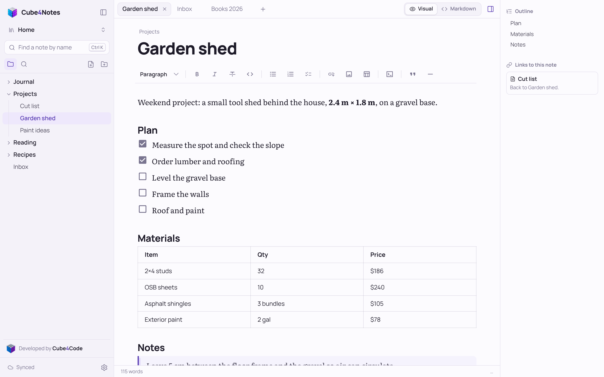
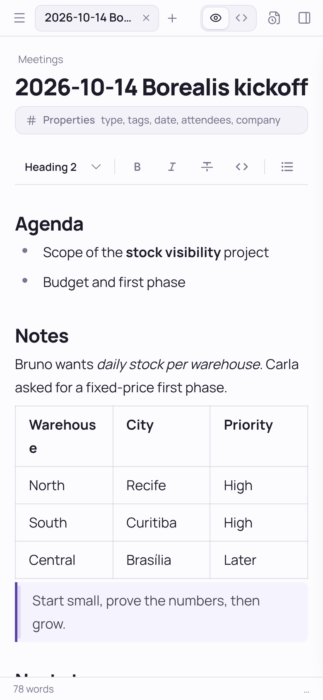
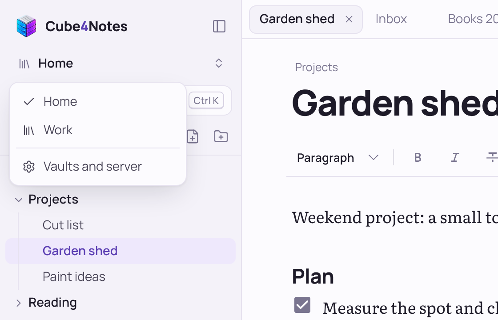
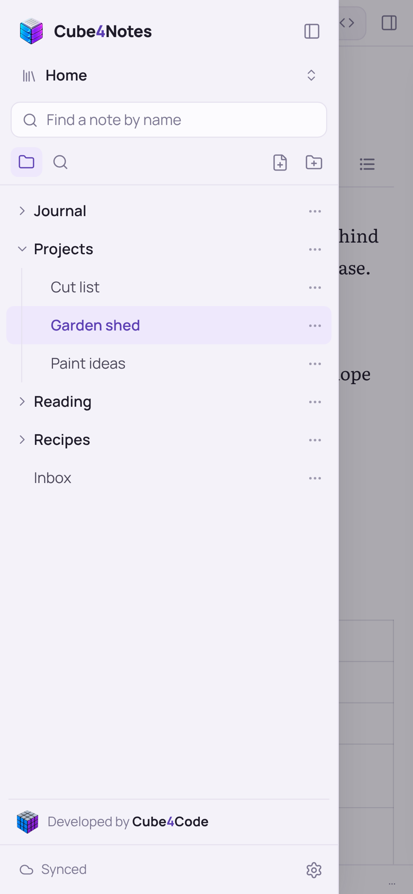
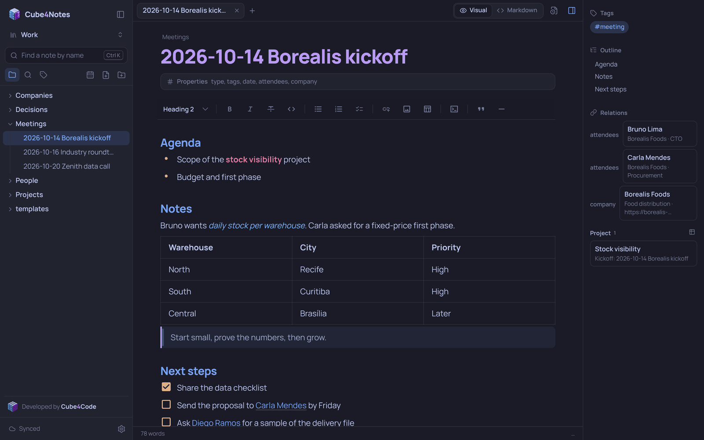

# Cube4Notes

**Suas notas em Markdown no seu próprio computador, e em todos os seus aparelhos. Mesmo offline.**

O Cube4Notes é um app de notas que guarda tudo como arquivos Markdown comuns num computador que é seu, oferece um editor visual moderno e leva as mesmas notas para o celular, o tablet e outros computadores, sem nenhum serviço de nuvem no meio.



> **Estado: protótipo funcionando.** O uso diário no Windows e no iPhone está em validação. Pode haver mudanças incompatíveis. English version: [README.md](README.md).

## Não precisa de servidor

O Cube4Notes roda **localmente, no computador que você já usa**. Basta rodar, e as notas ficam numa pasta desse computador. Não há servidor para comprar, rede para configurar nem conta para criar.

- **Só este computador.** Escolha *Só este computador* no assistente da primeira execução. O Cube4Notes atende só nesse computador, sem nada exposto na rede. Funciona como qualquer app de notas de desktop.
- **Qualquer outro aparelho que você quiser.** Escolha *Rede de casa*, e o mesmo computador passa a entregar as notas ao celular, tablet ou notebook pelo Wi-Fi. Leia um QR code em cada aparelho e pronto. Não há mais nada para instalar.
- **Uma máquina dedicada, só se você quiser.** Se preferir, rode o Cube4Notes numa máquina sempre ligada (um PC antigo, um mini PC, um Linux). As notas são arquivos comuns: mudar de um arranjo para outro é apontar o Cube4Notes para a mesma pasta.

Os aparelhos sincronizam com o computador quando estão na mesma rede que ele. Longe dele, cada aparelho continua funcionando com a cópia completa e sincroniza ao voltar. O Cube4Notes nunca expõe as notas à internet.

## Destaques

- **Markdown puro no disco.** Notas são arquivos `.md` comuns em pastas comuns. Sem banco de dados, sem formato próprio, nada para exportar.
- **Editor visual.** O Markdown vira formatação enquanto você digita: títulos, listas de tarefas, tabelas, blocos de código com destaque de sintaxe, imagens. `Ctrl+/` alterna para o Markdown puro. As edições geram diferenças pequenas e limpas.
- **Offline em primeiro lugar.** Cada aparelho guarda todas as notas a que tem acesso. Leia, crie, edite, renomeie, mova e exclua sem conexão; as alterações entram numa fila e sincronizam depois.
- **Nenhuma perda silenciosa.** Se a mesma nota mudou em dois lugares, uma versão fica e a outra é salva como `Nota (conflito Aparelho data).md`, com comparação lado a lado. Exclusões vão para a pasta `.lixeira`. Edições numa nota renomeada em outro aparelho seguem para o nome novo.
- **Vários vaults.** Qualquer pasta pode ser um vault. Cada aparelho acessa só os vaults que você escolher.
- **Conectar aparelho por QR code**, ou por um código de 6 caracteres. Convites são de uso único e valem 5 minutos. Ler um convite novo num aparelho já conectado atualiza o acesso dele. O acesso de um aparelho pode ser retirado na hora.
- **HTTPS local sem complicação.** No modo *Rede de casa* o Cube4Notes cria a própria autoridade certificadora, restrita a `localhost`, `*.local`, ao nome do computador e a IPs privados, então ela não serve para falsificar sites da internet.
- **Aplicativo de verdade.** O Cube4Notes abre numa janela própria, com o motor web do sistema (WebView2 no Windows, WebKit no Linux e no macOS). No modo *Rede de casa*, fechar a janela deixa ele rodando perto do relógio para os outros aparelhos continuarem sincronizando; o ícone reabre ou encerra. Máquinas sem tela rodam como servidor no console.
- **Navegação rápida.** Abas, árvore de pastas com arrastar e soltar, `Ctrl+K` para abrir notas e comandos, busca no conteúdo, painel de estrutura e de links para a nota.
- **53 temas de terminal** (Dracula, Nord, Gruvbox, Solarized, Catppuccin, Tokyo Night...) além de claro, escuro e sépia. Interface em português e inglês.

| Celular | Vaults | Tema de terminal |
| --- | --- | --- |
|  |   |  |

## Como começar (Windows)

Requisito: [.NET 10 SDK](https://dotnet.microsoft.com/download), ou o `Cube4Notes.exe` independente (veja abaixo), que não precisa de nada instalado.

1. Dê dois cliques no `Cube4Notes.exe` (ou, a partir do código, em `app/iniciar.cmd`).
2. O Cube4Notes abre numa janela própria de aplicativo (sem navegador e sem console). Na primeira execução, um assistente pergunta três coisas:
   - onde você vai usar: *Só este computador* ou *Rede de casa*;
   - a pasta do primeiro vault (qualquer pasta; se não existir, é criada, e arquivos `.md` que já estiverem nela aparecem como notas);
   - o nome deste aparelho.
3. Na primeira execução o Windows pede uma vez para confiar no certificado do Cube4Notes: aceite (ele só vale para endereços locais). No modo *Rede de casa* o Firewall do Windows também pode pedir acesso: permita em **redes privadas**.

Para conectar celular ou tablet: abra **Preferências > Conectar aparelho**, escolha os vaults que ele pode acessar e leia o QR code. Para o navegador parar de mostrar o aviso e o app abrir sem conexão, instale o certificado no aparelho uma vez (as instruções estão na mesma tela).

Tudo pode ser mudado depois em **Preferências > Vaults e servidor**: adicionar, renomear ou tirar vaults da lista, e trocar entre *Só este computador* e *Rede de casa* quando quiser.

Configurar uma máquina sem tela: inicie o Cube4Notes nela, abra `https://<ip-dela>:43125` em outro aparelho da mesma rede e digite o código de configuração mostrado no console.

### Executável independente

`app/gerar-executavel.cmd` gera um `Cube4Notes.exe` independente em `app/dist/win-x64`, que roda em qualquer Windows sem .NET. É um arquivo único, com a interface embutida: copie para onde quiser e dê dois cliques.

### Opções de linha de comando

| Opção | Efeito |
| --- | --- |
| `--config <pasta>` | Pasta da configuração (padrão `%LOCALAPPDATA%\Cube4Notes`) |
| `--port <número>` | Porta (padrão 43125; no modo *Rede de casa* a porta anterior redireciona HTTP para HTTPS) |
| `--notes <pasta>` | Importa uma pasta de notas como o vault "Notas" (atualização a partir do primeiro protótipo) |
| `--sem-janela` | Servidor no console, sem janela (para máquinas sem tela) |
| `--sem-navegador` | No modo console, não abre o navegador ao iniciar |
| `--sem-https` | HTTP simples na rede (só para testes) |
| `--sem-instalar-certificado` | Não adiciona o certificado à confiança do Windows |

## Plataformas

| Plataforma | Estado |
| --- | --- |
| Windows | Funcionando, em validação diária |
| iPhone / iPad (Safari, app na tela inicial) | Funcionando, em validação diária |
| Android, outros navegadores de computador | Devem funcionar, ainda não validados |
| Linux | Multiplataforma por construção (`net10.0`); script de compilação, CI e serviço em andamento |
| macOS | Planejado; compilado e testado só em CI |

## Princípios

- As notas são suas, num formato que qualquer editor abre.
- Só local: o Cube4Notes é acessível no computador onde roda e, se você ativar, na sua própria rede. Sem acesso externo, sem túnel, sem nuvem.
- Segurança faz parte do núcleo: token próprio por aparelho (guardado só como hash), verificação de Host e Origem, regras rígidas para anexos, revisão OWASP Top 10 ([app/SEGURANCA.md](app/SEGURANCA.md)).
- Fácil de configurar em qualquer ambiente: assistente no navegador na primeira execução, sem arquivos de configuração para editar à mão.

## Estrutura do repositório

```text
app/                        Cube4Notes (servidor, interface web, testes)
  Program.cs, src/          servidor: API mínima em .NET 10
  web/                      código-fonte da interface: TypeScript, Vite, Milkdown
  wwwroot/                  interface compilada, entregue pelo servidor
  dev/mock-server.mjs       servidor em Node com a mesma API, para desenvolver a interface e testar
  dev/teste_sync.py         testes maldosos de sincronização (dois aparelhos simulados)
  seguranca/                bateria de testes de segurança (OWASP Top 10)
services/api/               primeiro protótipo de servidor
apps/, packages/, services/mcp/   componentes planejados (cliente web, editor, contratos, integração com agentes)
docs/                       visão, arquitetura, plano de entrega, pesquisa e decisões
```

Mapa da documentação:

- [`docs/00-visao-e-escopo.md`](docs/00-visao-e-escopo.md): problema, público, escopo e limites.
- [`docs/01-arquitetura.md`](docs/01-arquitetura.md): componentes, fluxos, segurança e ambientes.
- [`docs/02-plano-de-entrega.md`](docs/02-plano-de-entrega.md): fases e critérios de saída.
- [`docs/05-cenarios-de-uso.md`](docs/05-cenarios-de-uso.md): cenário doméstico e aparelhos.
- [`docs/03-licenciamento.md`](docs/03-licenciamento.md): alternativas de licença.
- [`docs/04-pesquisa-e-evidencias.md`](docs/04-pesquisa-e-evidencias.md): fontes externas.
- [`AGENTS.md`](AGENTS.md): protocolo operacional obrigatório.
- [`app/README.md`](app/README.md): referência técnica do app (API, configuração, testes).

## Desenvolvimento

```bash
cd app/web
npm install
npm run build        # compila a interface para app/wwwroot
npm run dev          # servidor de desenvolvimento; rode o Cube4Notes na porta 43125 junto
```

Testes (Python 3; os de sincronização também precisam do Playwright):

```bash
python app/dev/teste_sync.py                                   # cenários maldosos de sincronização
python app/seguranca/teste_seguranca.py --lan https://<ip>:43125   # bateria de segurança contra um servidor rodando
python scripts/check_project.py                                # verificação da estrutura do repositório
```

## Próximos passos

- Script de compilação e CI no Linux (toda versão precisa compilar também no Linux)
- Janela própria (Photino.NET) para o modo *Só este computador*
- Instalar como serviço (serviço do Windows, systemd, launchd) e achar o servidor pelo nome na rede
- Tokens com escopo, somente leitura, por vault, para agentes de IA locais, com integração MCP
- Histórico automático opcional de cada vault com Git

## Licença

Nenhuma licença foi escolhida ainda. Até uma ser publicada, este repositório **não é open source**: todos os direitos reservados.

---

Desenvolvido por **Roberto Ritter** na [Cube4Code](https://cube4code.com).
