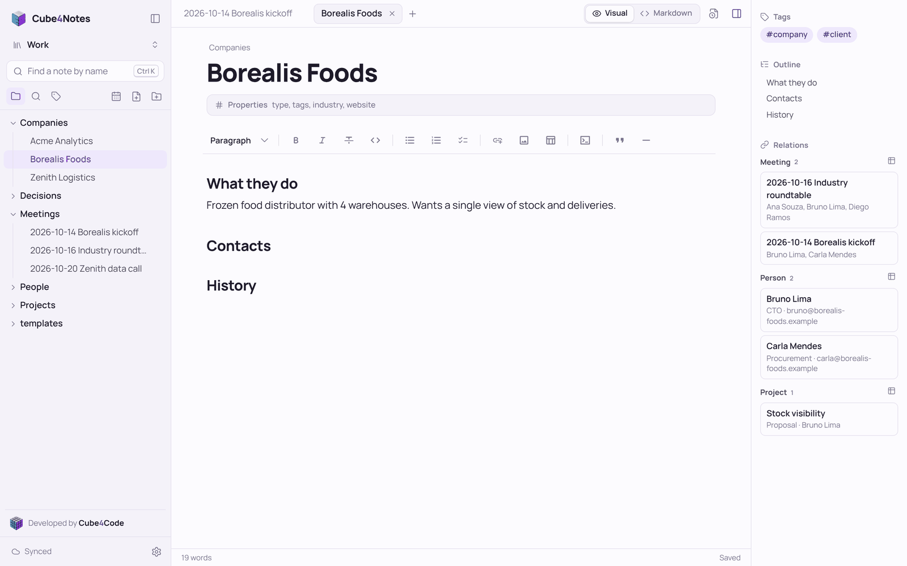
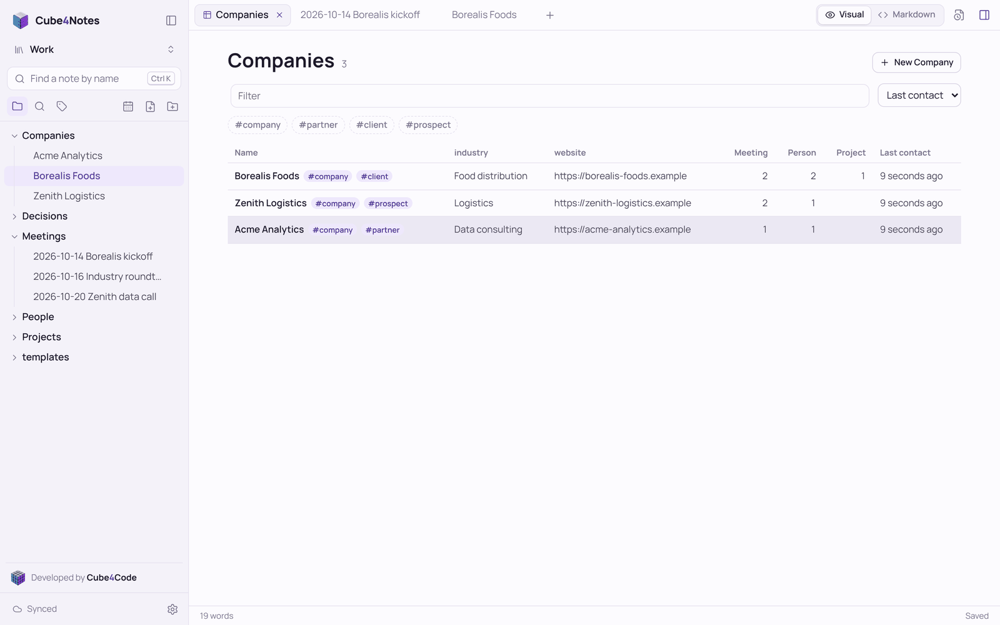
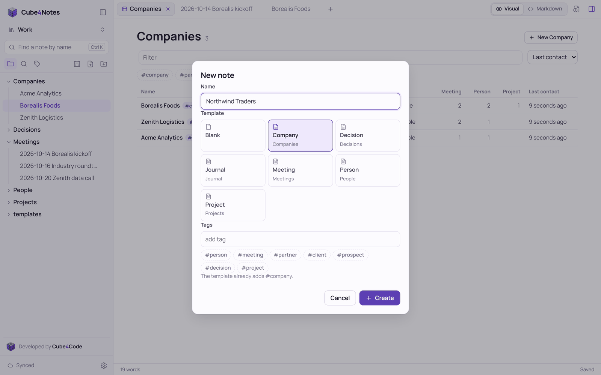
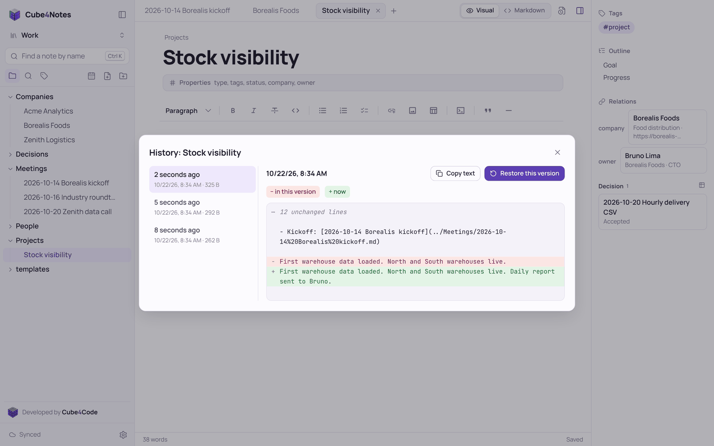
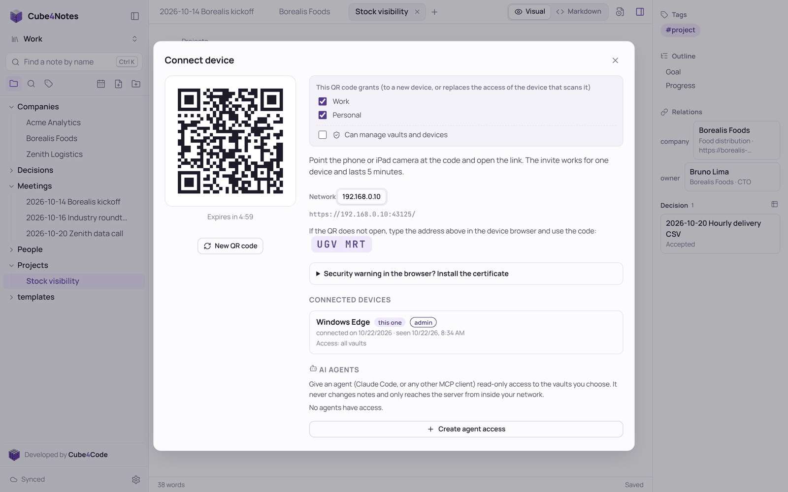
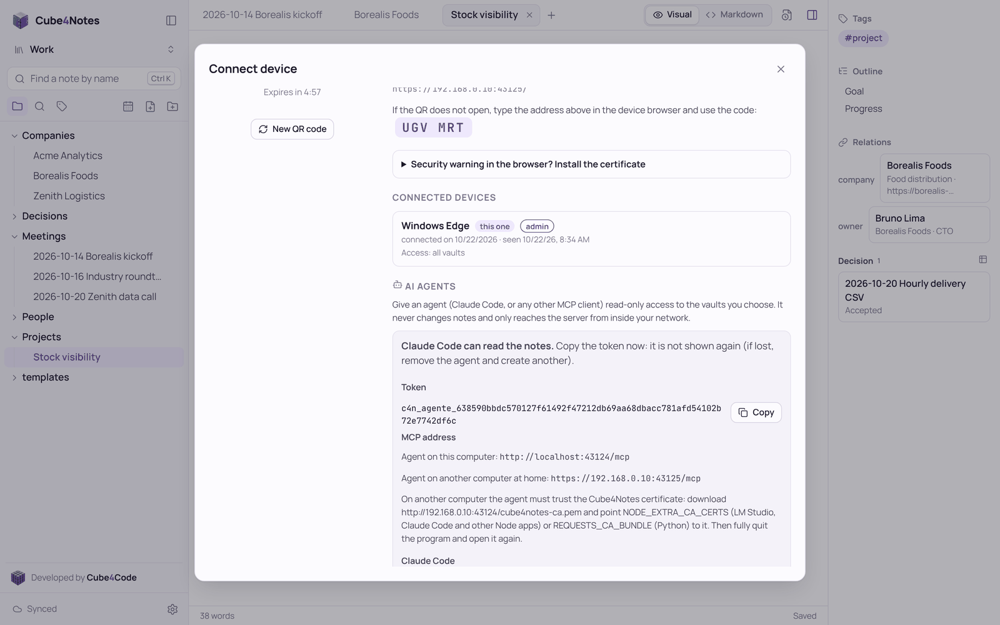
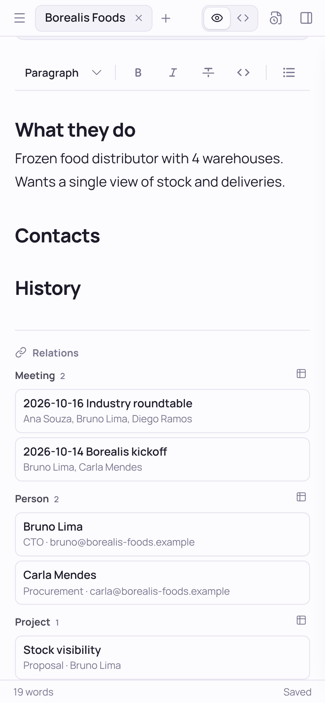

# Cube4Notes

**Suas notas em Markdown no seu próprio computador, e em todos os seus aparelhos. Mesmo offline.**

O Cube4Notes é um app de notas que guarda tudo como arquivos Markdown comuns num computador que é seu, oferece um editor visual moderno e leva as mesmas notas para o celular, o tablet e outros computadores, sem nenhum serviço de nuvem no meio.


> **Estado: protótipo funcionando.** O uso diário no Windows e no iPhone está em validação. Pode haver mudanças incompatíveis. English version: [README.md](README.md).

## Não precisa de servidor

O Cube4Notes roda **localmente, no computador que você já usa**. Basta rodar, e as notas ficam numa pasta desse computador. Não há servidor para comprar, rede para configurar nem conta para criar.

- **Só este computador.** Escolha *Só este computador* no assistente da primeira execução. O Cube4Notes atende só nesse computador, sem nada exposto na rede. Funciona como qualquer app de notas de desktop.
- **Qualquer outro aparelho que você quiser.** Escolha *Rede de casa*, e o mesmo computador passa a entregar as notas ao celular, tablet ou notebook pelo Wi-Fi. Leia um QR code em cada aparelho e pronto. Não há mais nada para instalar.
- **Uma máquina dedicada, só se você quiser.** Se preferir, rode o Cube4Notes numa máquina sempre ligada (um PC antigo, um mini PC, um Linux). As notas são arquivos comuns: mudar de um arranjo para outro é apontar o Cube4Notes para a mesma pasta.

Os aparelhos sincronizam com o computador quando estão na mesma rede que ele. Longe dele, cada aparelho continua funcionando com a cópia completa e sincroniza ao voltar. O Cube4Notes nunca expõe as notas à internet.

## Destaques

- **Markdown puro no disco.** Notas são arquivos `.md` comuns em pastas comuns. Sem banco de dados, sem formato próprio, nada para exportar.
- **Editor visual.** O Markdown vira formatação enquanto você digita: títulos, listas de tarefas, tabelas, blocos de código com destaque de sintaxe, imagens. `Ctrl+/` alterna para o Markdown puro. As edições geram diferenças pequenas e limpas.
- **Offline em primeiro lugar.** Cada aparelho guarda todas as notas a que tem acesso. Leia, crie, edite, renomeie, mova e exclua sem conexão; as alterações entram numa fila e sincronizam depois.
- **Nenhuma perda silenciosa.** Se a mesma nota mudou em dois lugares, uma versão fica e a outra é salva como `Nota (conflito Aparelho data).md`, com comparação lado a lado. Exclusões vão para a pasta `.trash`. Edições numa nota renomeada em outro aparelho seguem para o nome novo.
- **Vários vaults.** Qualquer pasta pode ser um vault. Cada aparelho acessa só os vaults que você escolher.
- **Conectar aparelho por QR code**, ou por um código de 6 caracteres. Convites são de uso único e valem 5 minutos. Ler um convite novo num aparelho já conectado atualiza o acesso dele. O acesso de um aparelho pode ser retirado na hora.
- **HTTPS local sem complicação.** No modo *Rede de casa* o Cube4Notes cria a própria autoridade certificadora, restrita a `localhost`, `*.local`, ao nome do computador e a IPs privados, então ela não serve para falsificar sites da internet.
- **Aplicativo de verdade.** O Cube4Notes abre numa janela própria, com o motor web do sistema (WebView2 no Windows, WebKit no Linux e no macOS). No modo *Rede de casa*, fechar a janela deixa ele rodando perto do relógio para os outros aparelhos continuarem sincronizando; o ícone reabre ou encerra. Máquinas sem tela rodam como servidor no console.
- **Links entre notas.** Digite `[[` para escolher a nota e o Cube4Notes grava um link Markdown padrão (`[Nota](pasta/Nota.md)`), que continua funcionando em qualquer editor. Renomeie ou mova uma nota, pasta ou anexo e todos os links acompanham. `Ctrl`+clique (ou um toque na tela) abre; link para nota que ainda não existe oferece criá-la.
- **Imagens e PDFs, também offline.** Cole ou arraste na nota. Ficam guardados no aparelho na hora, sobem quando o servidor responde, e as imagens usadas nas notas ficam em todos os aparelhos para aparecer longe de casa.
- **Histórico de versões.** Antes de uma nota ser sobrescrita, o texto anterior fica guardado no servidor (no máximo uma versão a cada 5 minutos de edição, até 100 por nota). Compare qualquer versão com o texto atual e restaure; restaurar nunca perde o texto atual.
- **Tags e propriedades.** `#tags` no texto ou na propriedade `tags:`, painel de tags e filtros na busca como `#projeto` ou `status:aberto`. As propriedades (YAML no topo da nota) são editadas como campos; YAML elaborado escrito à mão não é mexido.
- **Modelos, tipos e relações.** Modelos são notas comuns na pasta `modelos/` (`templates/` também vale), com tipo, campos, tags e a pasta onde a nota nova vai; conjuntos prontos (Trabalho, Pessoal, Leituras, Estudos, Projetos de software, Jogos de tabuleiro) ajudam a começar. Um campo que nomeia outra nota (`empresa: Empresa Y`) é uma relação: abra a empresa e veja as pessoas e reuniões agrupadas por tipo, ou a lista de todas as empresas com os campos como colunas, contadores de relações e último contato. Nota do dia a um clique (`Alt+D`). No celular, as relações aparecem abaixo da nota e as listas viram cartões. Tudo calculado no aparelho, também offline.
- **Acesso somente leitura para agentes de IA (MCP).** Dê a um agente, como o Claude Code, um token próprio, só de leitura, para os vaults escolhidos. Ele lista, busca e lê notas por MCP, nunca escreve, e só de dentro da sua rede.
- **Navegação rápida.** Abas, árvore de pastas com arrastar e soltar, `Ctrl+K` para abrir notas e comandos, busca no conteúdo, painel de estrutura e de links para a nota.
- **53 temas de terminal** (Dracula, Nord, Gruvbox, Solarized, Catppuccin, Tokyo Night...) além de claro, escuro e sépia, vindos do [Cube4Themes](https://github.com/robertoritter/Cube4Themes). Interface em português e inglês (escolhida em cada aparelho, em Preferências); o ícone ao lado do relógio, os avisos do Windows e o console seguem a língua do sistema, e os conjuntos de modelos são criados na língua da interface.

### Telas

As capturas mostram a interface em inglês; em português os textos são os mesmos, traduzidos.

| Relações entre notas | Listas por tipo |
| --- | --- |
|  |  |
| **Nota nova a partir de um modelo** | **Histórico de versões** |
|  |  |
| **Conectar celular ou tablet** | **Acesso somente leitura para agentes de IA** |
|  |  |
| **Vaults** | **Tema de terminal (Tokyo Night)** |
|  |  |

| Celular: editor | Celular: relações em cartões | Celular: lateral |
| --- | --- | --- |
|  |  |  |

## Como começar (Windows)

Requisito: [.NET 10 SDK](https://dotnet.microsoft.com/download), ou o `Cube4Notes.exe` independente (veja abaixo), que não precisa de nada instalado.

1. Dê dois cliques no `Cube4Notes.exe` (ou, a partir do código, em `app/run.cmd`).
2. O Cube4Notes abre numa janela própria de aplicativo (sem navegador e sem console). Na primeira execução, um assistente pergunta três coisas:
   - onde você vai usar: *Só este computador* ou *Rede de casa*;
   - a pasta do primeiro vault (qualquer pasta; se não existir, é criada, e arquivos `.md` que já estiverem nela aparecem como notas);
   - o nome deste aparelho.
3. Na primeira execução o Windows pede uma vez para confiar no certificado do Cube4Notes: aceite (ele só vale para endereços locais). No modo *Rede de casa* o Cube4Notes pede ao Windows, uma vez (confirmação de administrador), para abrir as duas portas dele, e as perguntas pelo nome, só para a rede local. Se um dia o celular parar de conectar, clique com o botão direito no ícone perto do relógio e escolha *Liberar no firewall*.

Para conectar celular, tablet ou outro computador, siga [Conectar um celular, passo a passo](#conectar-um-celular-passo-a-passo).

Tudo pode ser mudado depois em **Preferências > Vaults e servidor**: adicionar, renomear ou tirar vaults da lista, e trocar entre *Só este computador* e *Rede de casa* quando quiser.

Configurar uma máquina sem tela: inicie o Cube4Notes nela, abra `https://<ip-dela>:43125` em outro aparelho da mesma rede e digite o código de configuração mostrado no console.

### Executável independente

`app/build.cmd` gera um `Cube4Notes.exe` independente em `app/dist/win-x64`, que roda em qualquer Windows sem .NET. É um arquivo único, com a interface embutida: copie para onde quiser e dê dois cliques.

### Servidor Linux sem tela (serviço do systemd)

Para deixar as notas num servidor Linux sempre ligado (Debian, Ubuntu, Raspberry Pi OS; x64 ou ARM64, inclusive Mac com Apple Silicon rodando Linux):

1. Instale o .NET 10 SDK só para o seu usuário (não precisa de root):
   ```bash
   curl -sSL https://dot.net/v1/dotnet-install.sh | bash -s -- --channel 10.0
   export PATH="$HOME/.dotnet:$PATH"
   ```
2. Baixe o código e gere o executável (a plataforma da máquina é detectada sozinha):
   ```bash
   git clone https://github.com/robertoritter/cube4notes.git
   cd cube4notes/app
   ./build.sh
   ```
3. Instale como serviço (pede `sudo`; o serviço roda com o seu usuário, não como root, e inicia junto com a máquina):
   ```bash
   ./install-service.sh
   ```
   O script mostra as primeiras mensagens do Cube4Notes, com os endereços e o **código de configuração**.
4. Em outro aparelho da mesma rede, abra `https://<ip-do-servidor>:43125`, aceite o aviso do navegador (o certificado ainda não está instalado nesse aparelho), digite o código e escolha a pasta do primeiro vault, que fica no servidor.
5. Depois, conecte os aparelhos normalmente: [Conectar um celular, passo a passo](#conectar-um-celular-passo-a-passo). Reserve também o IP do servidor no roteador.

A configuração fica em `~/.local/share/Cube4Notes` do usuário do serviço. Comandos úteis: `journalctl -u cube4notes -f` (mensagens), `sudo systemctl restart cube4notes`. Para atualizar: `git pull`, `./build.sh` e `./install-service.sh` de novo (configuração, aparelhos e notas continuam). Se a máquina tiver firewall (por exemplo `ufw`), libere as portas 43124 e 43125 (TCP) e 5353 (UDP) para a rede local.

### Opções de linha de comando

| Opção | Efeito |
| --- | --- |
| `--config <pasta>` | Pasta da configuração (padrão `%LOCALAPPDATA%\Cube4Notes` no Windows, `~/.local/share/Cube4Notes` no Linux) |
| `--port <número>` | Porta (padrão 43125; no modo *Rede de casa* a porta anterior redireciona HTTP para HTTPS) |
| `--notes <pasta>` | Sem configuração existente, usa essa pasta como primeiro vault (atualização a partir do primeiro protótipo) |
| `--no-window` | Servidor no console, sem janela (para máquinas sem tela) |
| `--no-browser` | Não abre a janela nem o navegador ao iniciar |
| `--no-https` | HTTP simples na rede (só para testes) |
| `--no-cert-install` | Não adiciona o certificado à confiança do Windows |
| `--no-firewall` | Não cria a regra do Firewall do Windows |
| `--no-network-name` | Não responder por `<nome-do-computador>-notes.local` na rede local |

## Conectar um celular, passo a passo

Faça nesta ordem. Os passos 1 e 2 são feitos uma vez só e evitam quase todos os problemas.

1. **Fixe o IP do computador no roteador.** Nas configurações do roteador, procure *reserva de DHCP* (também chamada *IP fixo* ou *concessão estática*) e reserve o IP atual do computador que roda o Cube4Notes. Sem isso, o roteador pode dar outro IP ao computador um dia, e os aparelhos ficam em "Sem servidor" (veja [por quê](#como-os-aparelhos-acham-o-seu-computador)).
2. **Instale o certificado no aparelho.** No navegador do aparelho, abra `http://<ip-do-computador>:43124/cube4notes-ca.cer` e siga [Instalar o certificado](#instalar-o-certificado-no-celular-no-tablet-e-em-outros-computadores). No iPhone, não esqueça o último passo (Ajustes de Confiança de Certificados). Sem o certificado, o navegador mostra "Não seguro" e o app não abre longe de casa.
3. **Leia o QR code.** No computador, abra **Preferências > Conectar aparelho**, escolha os vaults que o aparelho pode acessar e aponte a câmera do aparelho para o QR code.

   
4. **Adicione à Tela de Início** (opcional). No iPhone, no Safari: Compartilhar > Adicionar à Tela de Início. O Cube4Notes passa a abrir como app, também sem conexão.

Pronto: o aparelho sincroniza sozinho na rede de casa e funciona offline fora dela.

### Problemas comuns

| O que acontece | Causa provável | O que fazer |
|---|---|---|
| A barra do Safari pisca entre o endereço e a busca, e nada abre | O Safari ficou preso numa tentativa anterior | Feche o Safari de vez (deslize para cima na troca de apps) e leia o QR code de novo |
| O navegador mostra "Não seguro" (*Not Secure*) | O aparelho não confia no certificado do Cube4Notes | Passo 2. Se já tinha instalado antes, apague o perfil antigo e instale de novo |
| "Sem servidor" de repente, sem ter mudado nada | O roteador deu outro IP ao computador | Passo 1, reservando o IP antigo; o app volta com tudo |
| "Sem servidor" só no celular, com o computador ligado | Celular fora do Wi-Fi de casa, ou firewall do Windows | Confira o Wi-Fi. No computador, clique com o botão direito no ícone perto do relógio > *Liberar no firewall* |
| "Este aparelho não consegue achar o computador pelo nome" | Certificado não instalado, ou rede que bloqueia nomes `.local` | Instale o certificado. Com o IP fixo (passo 1), o nome é dispensável |
| A interface está em outra língua | Cada aparelho segue a própria língua do sistema | Preferências > Idioma |

## Como os aparelhos acham o seu computador

O Cube4Notes nunca passa pela internet. O celular ou tablet conversa direto com o computador que guarda as notas, pelo Wi-Fi de casa. Por isso o **endereço** do computador importa, e vale saber como funciona.

**Dois tipos de endereço**

- **Pelo IP**, por exemplo `https://192.168.0.10:43125`. Funciona sempre na rede de casa, em qualquer aparelho. O problema: a maioria dos roteadores distribui os IPs sozinha e pode dar outro ao computador depois (`192.168.0.11`). Um aparelho que ainda aponta para o IP antigo deixa de achar o servidor, e o app fica em "Sem servidor".
- **Pelo nome**, por exemplo `https://meu-pc-notes.local:43125` (o nome do computador seguido de `-notes.local`). O aparelho pergunta à rede local "quem é meu-pc-notes.local?" e o Cube4Notes responde com o IP atual do computador. É o mesmo mecanismo (mDNS, também chamado Bonjour) que o celular usa para achar impressoras e caixas de som AirPlay. Quando o IP muda, o nome continua funcionando.

  Por que `-notes` e não só `meu-pc.local`? O sistema operacional também pode responder por `meu-pc.local`, e às vezes com o endereço de uma VPN ou placa de rede virtual que o celular não alcança. Com um nome só dele, só o Cube4Notes responde, sempre com o endereço da rede de casa.

**O que o Cube4Notes faz**

1. O QR code usa o IP, porque funciona em qualquer aparelho.
2. Logo depois de conectar, o app testa se este aparelho também acha o computador pelo nome. Se achar, oferece passar a usar o nome. A troca mantém o mesmo acesso do aparelho (sem QR novo), envia antes as alterações pendentes e baixa as notas de novo no endereço novo, então nada se perde. Também dá para fazer depois em **Preferências > Usar o nome do computador como endereço**.
3. No iPhone e no iPad, um site adicionado à Tela de Início pertence a um endereço. Depois da troca, adicione o Cube4Notes de novo à Tela de Início e apague o ícone antigo.

**O `meu-pc-notes.local` é sempre o meu computador, em qualquer rede?** Não, e tudo bem. Quem responde pelo nome é quem estiver na rede em que você está naquele momento:

- em casa, o seu computador responde;
- em outra rede (rua, escritório, dados móveis) ninguém responde, e o app simplesmente funciona offline, como sempre funciona longe de casa;
- se outra rede tiver um computador com o mesmo nome, o app mesmo assim se recusa a conectar: a conexão usa HTTPS com um certificado criado pelo seu próprio computador, que nenhuma outra máquina consegue apresentar. O token do aparelho também só vale no seu servidor.

**Onde o nome pode não funcionar**

- Wi-Fi de visitantes e redes que isolam os aparelhos bloqueiam essas perguntas pelo nome. Uma rede comum de casa permite.
- O Android resolve nomes `.local` de forma irregular, conforme a versão e o navegador. iPhone, iPad, macOS, Windows e Linux resolvem bem.
- O próprio Cube4Notes responde pelo nome, então não depende de o sistema fazer isso (o Windows muitas vezes não faz). No Windows ele também cria uma regra de firewall para as perguntas pelo nome (UDP 5353, só rede local) junto com a regra das portas dele. No Linux ele divide a porta com o `avahi-daemon`, se estiver rodando. Para desligar o nome, inicie o Cube4Notes com `--no-network-name`.
- Dois computadores com o mesmo nome na mesma rede confundem a resposta. Dê nomes diferentes a eles.

**A opção mais simples e robusta: IP fixo** (passo 1 de [Conectar um celular](#conectar-um-celular-passo-a-passo)). Nas configurações do roteador, procure *reserva de DHCP* (também chamada *IP fixo* ou *concessão estática*) e reserve o IP atual para o computador que roda o Cube4Notes. Assim o IP e o nome funcionam para sempre, em qualquer aparelho, inclusive Android. Com o IP fixo, usar o nome é opcional.

**Se um aparelho perdeu o servidor depois que o IP mudou:** reserve o IP antigo no roteador (o app volta com tudo, inclusive alterações feitas no aparelho que ainda não tinham subido), ou leia o QR code de novo (o aparelho baixa as notas de novo; alterações feitas nele que não subiram ficam no app antigo até o IP antigo voltar).

## Instalar o certificado no celular, no tablet e em outros computadores

No modo *Rede de casa* o Cube4Notes usa HTTPS com uma **autoridade certificadora criada no seu próprio computador**, que só vale para nomes locais e IPs privados. O computador do servidor confia nela sozinho. Cada outro aparelho precisa instalá-la **uma vez**; sem isso o navegador mostra avisos, o app não fica guardado no aparelho para usar longe de casa e a troca para o endereço pelo nome (veja acima) falha sem avisar.

O certificado fica sempre disponível, em HTTP comum para poder ser baixado antes de ser confiável, em `http://<ip-do-computador>:43124/cube4notes-ca.cer` (a porta é uma abaixo da do app). As mesmas instruções aparecem em **Preferências > Conectar aparelho**.

- **iPhone / iPad** (use o Safari; outros navegadores do iOS não instalam certificados):
  1. abra o endereço acima e permita o download;
  2. **Ajustes > Geral > VPN e Gerenciamento de Dispositivo**: instale o perfil "Cube4Notes CA (<nome do computador>)";
  3. **Ajustes > Geral > Sobre > Ajustes de Confiança de Certificados**: ligue a confiança total no "Cube4Notes CA". Esse último passo é fácil de esquecer e, sem ele, nada muda.
- **Android**: baixe o arquivo e vá em **Configurações > Segurança > Criptografia e credenciais > Instalar um certificado > Certificado CA**, escolha o arquivo e reabra o navegador. Os nomes dos menus variam conforme o fabricante.
- **Outro computador com Windows**: abra o arquivo e instale em *Autoridades de Certificação Raiz Confiáveis*. **macOS**: abra no Acesso às Chaves e marque *Sempre Confiar*. **Linux**: copie para o repositório do sistema (`/usr/local/share/ca-certificates/` e `update-ca-certificates` no Debian/Ubuntu); o Firefox pode precisar importar nas configurações dele.

**Sinais de que o aparelho não confia no certificado atual**

- O Safari ou o Chrome mostra *Não seguro* (*Not Secure*) ou um aviso de certificado ao lado do endereço.
- A barra de endereço pisca ou volta para a tela de busca depois de ler o QR code.
- O app não abre longe de casa, ou o Cube4Notes nunca oferece o endereço pelo nome.

**Quando a autoridade certificadora muda, todos os aparelhos precisam instalar de novo.** Ela é criada uma vez e fica na pasta de configuração (`%LOCALAPPDATA%\Cube4Notes\tls` no Windows). Ela é criada de novo se essa pasta for apagada, se o Cube4Notes rodar com outra pasta `--config`, ou em outro computador. Nesse caso, em cada aparelho, remova antes o perfil/certificado antigo e instale o novo. O nome do certificado mostra de qual computador ele é: "Cube4Notes CA (<nome do computador>)".

Só a *autoridade* precisa ser instalada. O certificado do próprio servidor é renovado sozinho quando os endereços do computador mudam, e os aparelhos que confiam na autoridade o aceitam sem fazer nada.

## Plataformas

| Plataforma | Estado |
| --- | --- |
| Windows | Funcionando, em validação diária |
| iPhone / iPad (Safari, app na tela inicial) | Funcionando, em validação diária |
| Android, outros navegadores de computador | Devem funcionar, ainda não validados |
| Linux (servidor sem tela, x64 e ARM64) | Funcionando como serviço do systemd (Debian 13); x64 testado no CI, ARM64 compila com o mesmo script mas ainda não foi testado |
| macOS | Executável gerado e testado no CI; falta o pacote `.app` com janela |

## Princípios

- As notas são suas, num formato que qualquer editor abre.
- Só local: o Cube4Notes é acessível no computador onde roda e, se você ativar, na sua própria rede. Sem acesso externo, sem túnel, sem nuvem.
- Segurança faz parte do núcleo: token próprio por aparelho (guardado só como hash), verificação de Host e Origem, regras rígidas para anexos, revisão OWASP Top 10 ([app/SECURITY.md](app/SECURITY.md)).
- Fácil de configurar em qualquer ambiente: assistente no navegador na primeira execução, sem arquivos de configuração para editar à mão.

## Estrutura do repositório

```text
app/                        o Cube4Notes ([referência técnica](app/README.md))
  Program.cs, src/          servidor: .NET 10 (ASP.NET Core)
  web/                      código-fonte da interface: TypeScript, Vite, Milkdown
  wwwroot/                  interface compilada, embutida no executável
  dev/                      servidor de teste em Node com a mesma API, e os testes
  security/                bateria de testes de segurança
  SECURITY.md              revisão OWASP Top 10 e riscos conhecidos
  build.cmd/.sh  executável independente (Windows / Linux e macOS)
  install-service.sh       serviço do systemd num Linux sem tela
docs/                       visão, arquitetura, estado, cenários, agentes, licença e decisões
.github/workflows/ci.yml    verificação a cada push
scripts/check_project.py    estrutura e links da documentação
```

## Documentação

A documentação técnica está em inglês.

| Documento | Para quê |
| --- | --- |
| [docs/00-vision-and-scope.md](docs/00-vision-and-scope.md) | o problema, para quem é, o que o Cube4Notes é e não é |
| [docs/01-architecture.md](docs/01-architecture.md) | como funciona por dentro: armazenamento, sincronização, rede, segurança, compilação |
| [docs/02-status-and-roadmap.md](docs/02-status-and-roadmap.md) | o que está pronto, em validação e os próximos passos |
| [docs/05-use-cases.md](docs/05-use-cases.md) | os cenários do dia a dia e como cada um funciona |
| [docs/06-ai-agents.md](docs/06-ai-agents.md) | dar a agentes de IA acesso de leitura às notas (MCP) |
| [docs/adr/](docs/adr/README.md) | as decisões de arquitetura, com contexto e alternativas |
| [docs/03-licensing.md](docs/03-licensing.md) | licenças comparadas antes da escolha da MIT |
| [app/README.md](app/README.md) | referência técnica: compilar, configuração, API, estrutura do código, testes |
| [app/SECURITY.md](app/SECURITY.md) | revisão OWASP Top 10 e riscos conhecidos |
| [AGENTS.md](AGENTS.md) | regras para quem (pessoa ou IA) mexe no código |

## Desenvolvimento

```bash
cd app/web
npm ci
npm run build        # compila a interface para app/wwwroot (commite junto)
npm run dev          # servidor de desenvolvimento; rode o Cube4Notes na porta 43125 junto
```

Testes (Python 3; os da interface também precisam do Playwright). A lista completa está na [referência técnica](app/README.md#tests):

```bash
python app/dev/test_sync.py                                   # cenários maldosos de sincronização
python app/security/test_security.py --lan https://<ip>:43125   # bateria de segurança contra um servidor rodando
python scripts/check_project.py                                # verificação da estrutura do repositório
python app/dev/test_executable.py app/dist/<plataforma>/Cube4Notes # o executável gerado, do jeito que um usuário novo usaria
```

Cada push na `main` e cada pull request rodam as mesmas verificações ([.github/workflows/ci.yml](.github/workflows/ci.yml)): o executável é gerado e testado no Windows, no Linux e no macOS, gerado e testado de novo num Debian mínimo sem bibliotecas extras, instalado como serviço do systemd, e os testes da interface rodam no servidor de teste.

## Próximos passos

- Versões publicadas no GitHub, com executáveis prontos para Windows e Linux
- macOS como app (pacote `.app` com janela); o executável já é gerado e testado no CI
- Validação no Android e numa janela de desktop Linux

Detalhes e o que já está pronto: [docs/02-status-and-roadmap.md](docs/02-status-and-roadmap.md).

## Licença

O Cube4Notes é open source, sob a [licença MIT](LICENSE). Os nomes Cube4Notes e Cube4Code e as logos não são cobertos pela licença.

---

Desenvolvido por **Roberto Ritter** na [Cube4Code](https://cube4code.com).
